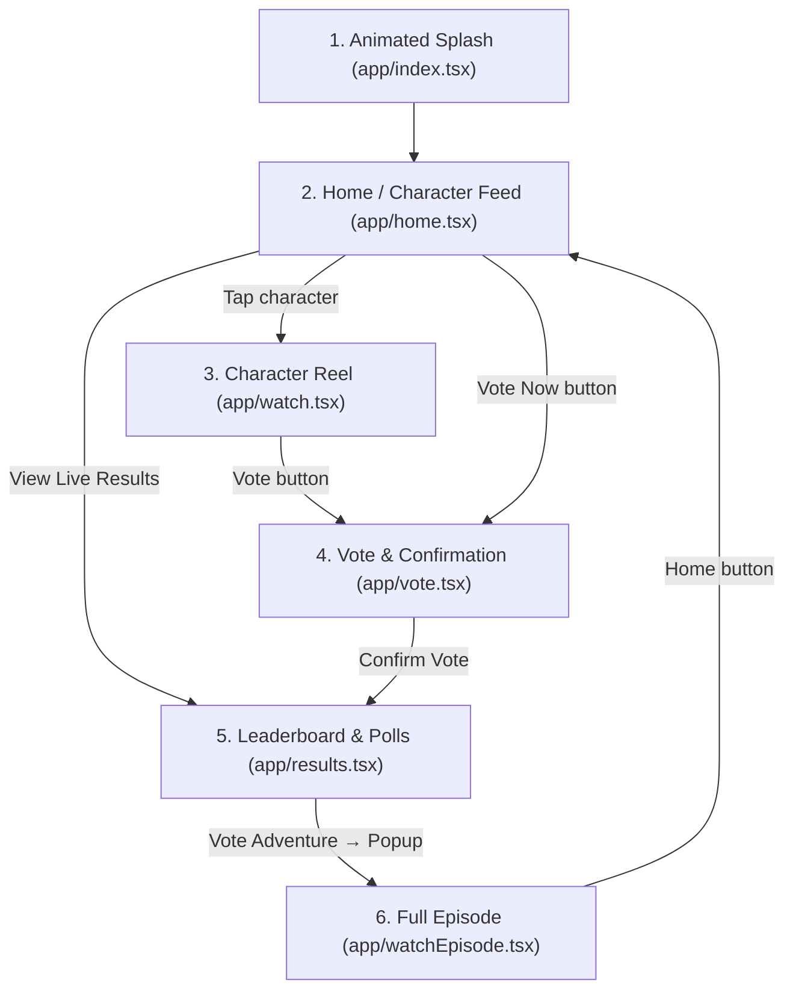

# Darkgrevil App — Page-by-Page Overview

This document provides a comprehensive overview of all pages, navigation flows, and components across the **Darkgrevil** mobile application.

---

## 🗺️ Application Navigation Architecture

---

## 📄 Screen Breakdown

### 1. Root Layout — [`app/_layout.tsx`](./app/_layout.tsx)

- **Route:** Root Application Stack
- **Role:** The application container and navigation wrapper.
- **Core Responsibilities:**
  - Wraps the application tree in `GestureHandlerRootView` for gesture support.
  - Enforces an app-wide light status bar (`<StatusBar style="light" />`) against the dark theme.
  - Configures the Expo Router `Stack` with headers disabled (`headerShown: false`) and a global black background (`contentStyle: { backgroundColor: '#000000' }`).

---

### 2. Animated Splash Screen — [`app/index.tsx`](./app/index.tsx)

- **Route:** `/`
- **Role:** The initial animated launch screen.
- **Core Features:**
  - **Animations:** Uses React Native's `Animated` API to concurrently run:
    - Opacity fade-in from `0` to `1` over 1000ms.
    - Spring scale effect expanding the logo from `0.9` to `1.0`.
  - **Auto-Navigation:** A 3-second timer (`setTimeout`) triggers `router.replace('/home')`, seamlessly replacing the splash screen so users cannot navigate back to it.

---

### 3. Home Screen — [`app/home.tsx`](./app/home.tsx)

- **Route:** `/home`
- **Role:** Primary hub for browsing characters and initiating interactions.
- **Core Features:**
  - **Header:** Displays user avatar (`avatar.png`) and greeting (_"Hello, Khaled 👋 - Ready to choose your favorite?"_).
  - **Character Grid:** 2-column responsive layout rendering all candidates from [`constants/MockData.ts`](./constants/MockData.ts).
  - **Selection Logic:**
    - **Tapping any Character:** Selects the character and immediately opens their 30-second short video reel in [`app/watch.tsx`](./app/watch.tsx) with `{ id: character.id }`.
  - **Sticky Footer Actions:**
    - **"Vote Now" Button:** Enabled only when a character is highlighted; routes to [`app/vote.tsx`](./app/vote.tsx).
    - **"View Live Results" Button:** Direct route to [`app/results.tsx`](./app/results.tsx).

---

### 4. Character Video Reel — [`app/watch.tsx`](./app/watch.tsx)

- **Route:** `/watch?id=:id`
- **Role:** Full-screen vertical character reel (TikTok / Reels format).
- **Core Features:**
  - **Video Engine:** Integrated with `react-native-youtube-iframe` for native YouTube streaming, centered in 16:9 aspect ratio with Android software rendering layer compatibility and fallback to direct MP4 streams via `expo-video`. Auto-detects YouTube URLs and extracts video IDs dynamically.
  - **30-Second Loop:** Restricts playback duration to 30 seconds and automatically restarts seamlessly.
  - **Animated Progress Bar:** Tracks and displays playback progression (`0%` to `100%`) across the bottom edge.
  - **Controls & Overlays:**
    - Top bar: Circular back button and mute/unmute toggle (`Volume2` / `VolumeX`).
    - Bottom overlay: Character circular avatar and name.
    - **Purple Vote Button:** Floating pill button (`💜 Vote`) that directly opens [`app/vote.tsx`](./app/vote.tsx) with the character's voting confirmation modal.

---

### 5. Vote Screen & Confirmation — [`app/vote.tsx`](./app/vote.tsx)

- **Route:** `/vote`
- **Role:** Voting interface and submission confirmation.
- **Core Features:**
  - **Header:** Back navigation with heading (_"Choose your favorite - You can vote once. Choose wisely"_).
  - **Character Grid:** Multi-column grid using [`components/CharacterCard.tsx`](./components/CharacterCard.tsx).
  - **Confirmation Slide-Up Sheet (Modal):**
    - Selecting any character triggers a slide-up modal with blurred backdrop.
    - Displays selected candidate portrait with warning (_"This action cannot be undone."_).
    - **Cancel:** Dismisses sheet.
    - **Confirm Vote:** Commits vote and navigates to [`app/results.tsx`](./app/results.tsx).

---

### 6. Live Results & Next Adventure Poll — [`app/results.tsx`](./app/results.tsx)

- **Route:** `/results`
- **Role:** Live voting standings leaderboard and user poll for the next storyline.
- **Core Features:**
  - **Leaderboard Section:** Shows top 5 ranked characters via [`components/LeaderboardItem.tsx`](./components/LeaderboardItem.tsx) with rank numbers/medals, avatars, names, and current vote counts (e.g. `24.5k`).
  - **Next Adventure Poll:** Interactive radio selector list (options: _Mountains, Bicycles, Swimming, Boating, Space ship_).
  - **Vote Confirmation Modal:**
    - Voting on an adventure displays an animated checkmark modal (_"Thanks for voting!"_).
    - Tapping **"— Enjoy!"** routes directly into [`app/watchEpisode.tsx`](./app/watchEpisode.tsx).

---

### 7. Full Episode Watch Page — [`app/watchEpisode.tsx`](./app/watchEpisode.tsx)

- **Route:** `/watchEpisode`
- **Role:** Full-length media player with episode details and series metadata.
- **Core Features:**
  - **Header:** Top bar with a circular Home icon button returning to `/home`.
  - **Video Player:** Embedded 16:9 `<VideoView />` supporting native player controls, full-screen expansion, and Picture-in-Picture (PiP).
  - **Episode Metadata:**
    - Title (_"Great Episode of the Winners"_).
    - Badges: `SEASON FINALE` tag, duration (`20 min`), episode number (`Episode 12`).
    - Expandable synopsis/description with "Show more" button.

---

## 🧩 Shared Components & Constants

| File                                                                 | Purpose                                                                                    |
| :------------------------------------------------------------------- | :----------------------------------------------------------------------------------------- |
| [`components/CharacterCard.tsx`](./components/CharacterCard.tsx)     | Reusable voting card displaying character portrait, status, and selection state.           |
| [`components/LeaderboardItem.tsx`](./components/LeaderboardItem.tsx) | Leaderboard row component displaying rank number, avatar, name, and vote count.            |
| [`constants/MockData.ts`](./constants/MockData.ts)                   | Centralized data source containing candidate character entries and adventure poll choices. |
| [`constants/Theme.ts`](./constants/Theme.ts)                         | Color tokens (primary, dark backgrounds, accents), spacing units, and typography presets.  |
