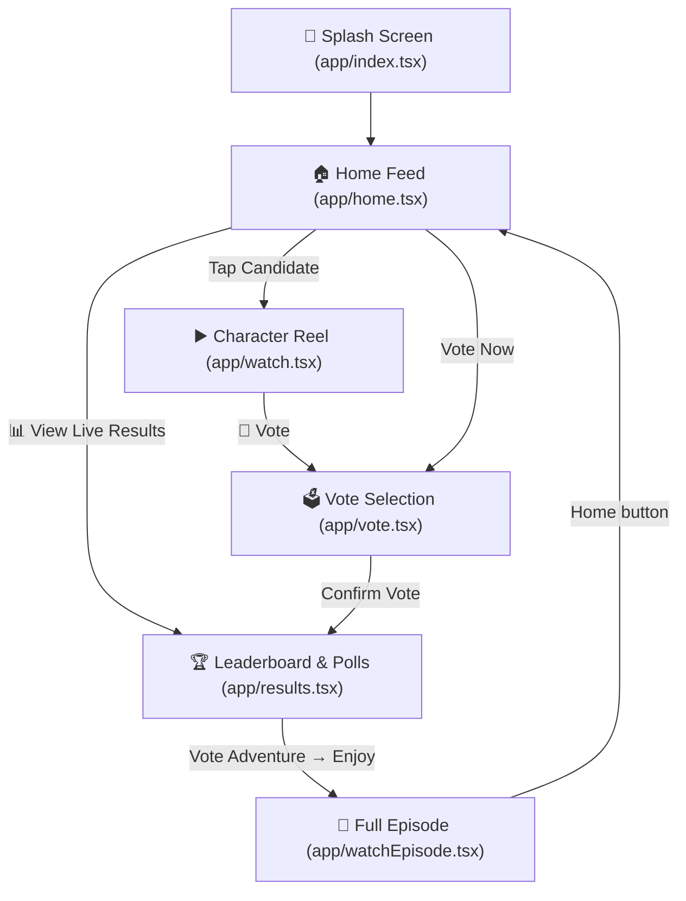

# 🎬 Dark Grevil

> An interactive personality voting and multimedia mobile experience built with **React Native**, **Expo Router**, and **Expo Video**.

**Author:** Dr. Khaled Alghanim  
**Platform:** Android, iOS, Web  
**Theme:** Dark Neon / Cyberpunk Aesthetic (`#000000` with `#7C3AED` Violet Accents)

---

## 📖 Overview

**Dark Grevil** is a mobile application where users can discover candidates and personalities, watch short candidate video reels, cast their votes with local persistent quota tracking (up to 5 votes per user), inspect real-time leaderboard standings, participate in future adventure storyline polls, and watch the full final episode.

---

## ✨ Features

- **🎬 Native Video Reels & Episode Playback:**
  - High-performance native video streaming powered by [`expo-video`](https://docs.expo.dev/versions/latest/sdk/video/).
  - Vertical short-form personality reels with audio normalization, custom replay controls, progress indicators, and mute/unmute toggles.
  - Dedicated full-length episode player with synopsis expansion.

- **🗳️ Persistent Local Voting System (5-Vote Quota):**
  - Offline-first vote persistence backed by `@react-native-async-storage/async-storage`.
  - Maximum **5 votes** total per device.
  - Real-time reactive updates across all mounted screens via event listeners in [`utils/voteStorage.ts`](./utils/voteStorage.ts).
  - Voted candidates receive grayed-out badges and disabled buttons to prevent duplicate votes.

- **🏆 Live Leaderboard & Adventure Polls:**
  - Dynamic standings ranking candidates by vote volume.
  - Interactive "Next Adventure" user poll determining the setting for upcoming episodes.

- **🎨 Modern Dark Theme UI:**
  - Immersive pure black background (`#000000`) optimized for OLED displays.
  - Smooth spring and fade animations using React Native's `Animated` API.
  - Sleek top-right card status indicators and glassmorphic card containers.

---

## 📱 Screen Directory & Navigation Flow



| Screen             | Route                                            | Description                                                                                |
| :----------------- | :----------------------------------------------- | :----------------------------------------------------------------------------------------- |
| **Splash Screen**  | [`app/index.tsx`](./app/index.tsx)               | Brand intro with spring scale and opacity animations, auto-transitioning to Home.          |
| **Home Screen**    | [`app/home.tsx`](./app/home.tsx)                 | Candidate grid, greeting, remaining vote counter, and quick navigation.                    |
| **Watch Screen**   | [`app/watch.tsx`](./app/watch.tsx)               | Vertical video clip with replay overlay, progress bar, audio toggle, and vote pill button. |
| **Vote Screen**    | [`app/vote.tsx`](./app/vote.tsx)                 | Candidate cards with slide-up confirmation sheet and quota validation.                     |
| **Results Screen** | [`app/results.tsx`](./app/results.tsx)           | Top candidate leaderboard standings and interactive adventure storyline poll.              |
| **Watch Episode**  | [`app/watchEpisode.tsx`](./app/watchEpisode.tsx) | 16:9 full-length episode video player with series details and expandable description.      |

---

## 🛠️ Tech Stack & Dependencies

- **Framework:** [Expo](https://expo.dev/) (SDK 54) & [React Native](https://reactnative.dev/) (0.81.5)
- **Routing:** [Expo Router](https://docs.expo.dev/router/introduction/) v6 (File-based navigation)
- **Video Player:** [`expo-video`](https://docs.expo.dev/versions/latest/sdk/video/)
- **Local Storage:** [`@react-native-async-storage/async-storage`](https://react-native-async-storage.github.io/async-storage/)
- **Icons:** [`lucide-react-native`](https://lucide.dev/)
- **Safe Area & Gestures:** `react-native-safe-area-context` & `react-native-gesture-handler`
- **Language:** TypeScript 5.9 with strict type checking

---

## 🚀 Getting Started

### Prerequisites

Ensure you have the following installed:

- [Node.js](https://nodejs.org/) (v18 or higher recommended)
- [Android Studio](https://developer.android.com/studio) with Android SDK and an AVD emulator (or a physical Android device with USB debugging enabled)
- Git

### Installation

1. **Clone the repository:**

   ```bash
   git clone <repository-url>
   cd darkgrevil-rn-app
   ```

2. **Install project dependencies:**

   ```bash
   npm install
   ```

3. **Start the Metro development server:**
   ```bash
   npx expo start
   ```

### Running on Android

To run on an Android emulator or connected device with native modules compiled:

```bash
npx expo run:android
```

Or start the Metro bundler directly:

```bash
npx expo start -c
```

Then press `a` in the terminal to launch the Android app.

### Running on Web

```bash
npx expo start --web
```

---

## 📂 Project Architecture

```
darkgrevil-rn-app/
├── app/                      # Expo Router file-based pages
│   ├── _layout.tsx           # Global root layout and gesture root
│   ├── index.tsx             # Animated splash screen
│   ├── home.tsx              # Main character grid feed
│   ├── watch.tsx             # Character vertical video player
│   ├── vote.tsx              # Voting selection & confirmation modal
│   ├── results.tsx           # Standings leaderboard & adventure poll
│   └── watchEpisode.tsx      # Full episode player & details
├── assets/                   # Static assets (images, icons, video clips)
│   ├── images/               # Candidate portraits and avatars
│   └── video/                # Normalized character clips & episode media
├── components/               # Reusable UI components
│   ├── CharacterCard.tsx     # Voting card with top-right status badges
│   └── LeaderboardItem.tsx   # Leaderboard rank row
├── constants/                # App-wide configurations
│   ├── MockData.ts           # Candidate profiles, adventure options
│   └── Theme.ts              # Design tokens (Colors, Spacing, Typography)
├── utils/                    # Core utilities & storage engines
│   └── voteStorage.ts        # AsyncStorage persistence and useVoteStatus hook
├── app.json                  # Expo project manifest
├── package.json              # Project scripts & dependencies
└── tsconfig.json             # TypeScript compiler settings
```

---

## 🔒 Voting Rules & Business Logic

1. **Total Vote Allowance:** Each user/device is allocated a maximum of **5 votes** total.
2. **Single Vote per Personality:** Once a character receives a vote, their card is marked as `Voted` and subsequent votes for that personality are disabled.
3. **Card & Button State Transitions:**
   - **Active:** Violet button (`#7C3AED`) with white heart icon.
   - **Voted:** Turns gray (`#374151`) with gray checkmark badge, reading `Voted` and disabled.
   - **Quota Exhausted:** If all 5 votes are consumed, remaining unvoted candidates display `Max 5 Votes` and cannot be submitted.
4. **Data Reset:** Stored votes can be cleared programmatically using `resetVotes()` from [`utils/voteStorage.ts`](./utils/voteStorage.ts).

---

## 👤 Author

Developed by **Dr. Khaled Alghanim**

---

## 📄 License

This project is private and proprietary. All rights reserved.
